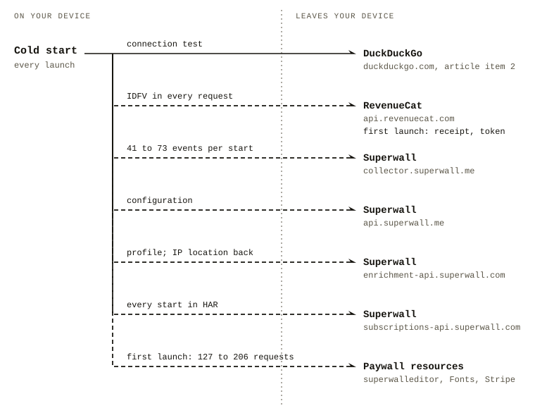
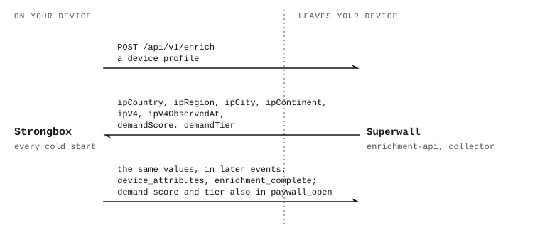

# Strongbox for iOS (in-app purchase variant): a study of its network traffic. Short report

**Version 1.0 of 19 October 2026.** This is the short report; the full report with all observations, sources and the complete correspondence is `FULL-REPORT.md` (same directory). Section numbers are the same as in the full report, and references of the form "(full report, 3.x)" and "(3.x)" point to it.

Authors: paying Strongbox users, anonymous. Contact: see section 7.

## Prologue

*This prologue describes the authors' personal experience and impressions; the report itself starts in section 1.*

> We are active Strongbox users. We chose it because it met all our functional requirements. The privacy policy, linked from the app and the App Store, and the support article the policy linked to, answered our doubts. The article also encouraged users to check the connections themselves. We had no concerns.

> At the end of September 2026, entirely by chance, one of us was using the iOS App Privacy Report to see how many domains a different app, one used for testing connections, was contacting, and noticed a strangely large number of connections from Strongbox to domains the app's documentation did not mention (two screenshots: [1](sources/P0_app-privacy-report_domains_2026-09-30.png), [2](sources/P0_app-privacy-report_most-contacted_2026-09-30.png)). Intrigued, we decided to look into it.

## In one minute

- On every launch the app connects to two outside companies, RevenueCat and Superwall, also when the user pays (3.1).
- It sends them a persistent device identifier and, to Superwall, an identifier tied to the Apple account (3.3).
- It receives from Superwall a location derived from the IP address and a purchase propensity score, and sends them back (3.5).
- The content of password databases is not sent (section 4).
- The privacy policy in force said the app used no vendors or analytics providers; after the authors' questions it was changed (3.1, section 6).

## Summary

On every launch, the tested version of the app connects to two external services: RevenueCat (purchase handling) and Superwall (purchase screens), whether or not the user has a subscription (full report, 3.1). On every start, several dozen events with a device profile go to Superwall, including the device identifier (IDFV), the App Store transaction identifier, model, operating system, language, region, currency, time zone, dark mode and connection type (3.2). The service returns a location derived from the IP address and a purchase propensity score ("demand score"), and the app sends them back in later events (3.5). The same device identifier goes to RevenueCat (3.3).

On the first launch after installation, the app sends an Apple AdServices attribution token to RevenueCat, which in this SDK version has to be switched on by the app (3.4). The content of password databases is not sent. After a database is opened, in the 6 observed unlocks the app sent no events concerning the database (one exception, most likely triggered by the user, is described in 3.8). No connection from Strongbox to Sentry was observed (DNS lookups of `sentry.io` without a connection, of unestablished origin: section 4).

The privacy policy in force at the time of the study (as of 9 May 2024) stated that the app uses no vendors or analytics providers and collects no location data. The vendor's article on network connections did not list these services. The vendor's public statements (post of 26 January 2026, D16; interview of 1 August 2026, D15) described the data as limited to paywall events. After the authors' questions, the vendor changed both documents (policy: 15 October 2026; article: between 14 and 16 October 2026, according to the authors' account): the new versions name RevenueCat and Superwall, device identifiers, approximate location derived from the IP address, an estimate of purchase likelihood, and operation with an active subscription (3.1, 3.5).

Most of the observed behaviour matches the default settings of both SDKs; in the app's public code (state 1.65.0) both SDKs are configured with defaults apart from the StoreKit version, and none of the available options to limit data collection is used (3.10, 3.11). The flow to Superwall is the same on the device with an active subscription, to which, under the configuration, no paywall can be shown. The App Store privacy label lists one data type ("Purchase History", purpose "Analytics", not linked to the user) and, according to web archive snapshots, has not changed since 8 January 2026, including after Superwall was added (as of 18 October 2026); the traffic contains data that match Apple's definitions of Device ID, Coarse Location and Product Interaction (3.9).

The vendor replied on 14 October 2026 in broad strokes and on 16 October 2026 under each question (quoted in full in the full report, section 6): the privacy policy remained out of date by mistake; the AdServices token serves Apple Search Ads attribution; App Tracking Transparency is not used; the vendor does not use the location derived from the IP address or the demand score; paywalls are preloaded for subscribers too, in case the entitlement is lost; the user currently cannot turn the event collection off; no release note named Superwall, only the launch post on Reddit (D16). Several questions remained unanswered (section 6). This report describes traffic leaving the phone. It does not describe what the recipients do with the data, and it attributes no intent to the vendor.

*Figure 1. Where data goes on a cold start (Exhibit 2 on the Evidence page of the web publication); dashed: not listed in the vendor's article of 8 October 2026.*

*Figure 2. The enrich exchange on every cold start, field names only (Exhibit 8).*

## 1. What was studied and what was not (full report, 1)

App: Strongbox - Password Manager, App Store, bundle `com.markmcguill.strongbox`, version 1.65.2 (build 152), in-app purchase variant; SDKs according to request headers: RevenueCat 5.21.1, Superwall 4.15.3. Out of scope: Strongbox Pro (one-off purchase), Strongbox Zero, the macOS version. Subject: connections made by the app to the RevenueCat and Superwall services and to paywall resources, set against the wording of the vendor's public declarations. Other connections (Sentry, favicons, the `duckduckgo.com` connectivity test) were observed but are not the subject of this report. Within the scope examined, no discrepancy with the declarations was found in them (section 4). The report describes what the app sends and when.

## 2. How it was studied (full report, 2)

Three iPhones owned by the authors: A (annual Pro subscription, active), B (entitlement through Family Sharing until 3 October, then expired; fresh installation on 3 October) and C (never installed before, no purchase). Tools: Proxyman (macOS) with TLS decryption for the RevenueCat, Superwall and Google Fonts hosts and `js.stripe.com` (HAR: decrypted HTTP log); Proxyman for iOS on the device in A0, S02, S17 and S18; `rvictl` + Wireshark (PCAP: full packet capture). Apple domains were not decrypted. Runs:

| Run | Date | Device | Activity | Capture | VPN |
|---|---|---|---|---|---|
| A0 | 1 Oct | A | launch, 1.5 min on the home screen | HAR (domain filter), PCAP | no |
| S02 | 1 Oct | A | 3 cold starts, database locked | HAR (domain filter), PCAP | no |
| S01 | 1 Oct | B | first launch after installation | HAR, PCAP | no |
| S11b | 1 Oct | A | 6 app openings, including 2 cold starts; crash reporting option off/on | HAR, PCAP | no |
| S17 | 3 Oct | B | fresh installation without entitlement, 1 cold start, background/foreground transitions | HAR, PCAP | yes |
| S18 | 3 Oct | B | cold start, unlock of a test database, browsing entries, favicons | HAR (domain filter), PCAP | yes |
| T1 | 3 Oct | B | 5 min, app closed, without Proxyman | PCAP | yes |
| T2 | 3 Oct | B | 3 cold starts, without Proxyman | PCAP | yes |
| T3 | 3 Oct | B | 3 cycles: cold start, unlock, 2 entries, lock, background | HAR, PCAP | yes |
| A5 | 5 Oct | A | 2 × (installation, first launch) | HAR | yes |
| A8 | 8 Oct | A | installation, first launch, 3 starts | HAR | yes |
| C8 | 8 Oct | C | first launch, 2 cold starts, database creation, 2 unlocks | HAR | no (mobile connection) |

"Domain filter": an export that contains only selected hosts (section 5).

A VPN on the router, with its exit in another country, was active in the runs of 3, 5 and 8 October on A and B. This was established from the country derived from the IP address that the Superwall service returns, and from the authors' account. In total, 24 cold starts (A 12, B 9, C 3).

In the published HAR files (`data/`), identifiers, tokens, addresses, purchase dates and prices are replaced with labels (the same value gives the same label in every file), server addresses with labels of the form `<<IP_n>>`, and all timestamps are shifted by a constant random value per run, so times should not be compared between files. From the packet captures only extracts are published, without content (full report, 2, "Pseudonymisation"). A "CONNECT" entry in a HAR file is a connection whose content was not decrypted.

### Terms

- **HAR**: a log of decrypted HTTP requests and responses, here from Proxyman.
- **PCAP**: a full packet capture; here only extracts are published.
- **SNI**: the server name sent in the clear at the start of a TLS connection; it shows which hosts a capture without decryption reached.
- **DNS**: the lookup of a host name's addresses.
- **CONNECT**: a HAR entry for a connection whose content was not decrypted.
- **IDFV** (identifierForVendor): an identifier iOS gives to all apps of one vendor on a device, kept while at least one of those apps stays installed.
- **IDFA** (Identifier for Advertisers): an identifier requested through App Tracking Transparency; not seen in the traffic.
- **ATT** (App Tracking Transparency): the iOS consent prompt through which an app requests the IDFA.
- **StoreKit**: Apple's purchase framework; the receipt comes from it.
- **Paywall**: the purchase screen; Superwall delivers and configures it.
- **Trigger** or **placement**: a named point in the app at which a paywall can be shown, under rules from the configuration.
- **Entitlement**: an active right to the paid features; here from a subscription or Family Sharing.
- **Demand score**: a number from 1 to 100 that Superwall assigns to each user on every app open (D20).
- **HTTP/2 coalescing**: two host names served over one connection, so that only one name is visible in the capture.

## 3. Observations next to the wording of the declarations

Labels: **F** (fact from a file, with its location), **D** (document, with address and date of access), **R** (the vendor's replies to the authors of 14 and 16 October 2026, quoted in full in the full report, section 6), **I** (inference: a conclusion drawn by the authors), **H** (hypothesis). Document codes (D1–D21, EP1–EP7a, P0) refer to the files and addresses listed in `sources/README.md`.

### 3.1 Connections on every cold start (full report, 3.1)

*On every start the app contacts the two services, whether or not the user pays.*

F: In each of the 21 cold starts recorded in HAR, the app connected to the following five hosts.

| Host | What it carries |
|---|---|
| `api.revenuecat.com` | purchase handling: the IDFV in every request; on first launch the receipt and the attribution token (3.3, 3.4) |
| `api.superwall.me` | paywall configuration (3.7) |
| `collector.superwall.me` | events with the device profile, 41 to 73 per start (3.2) |
| `enrichment-api.superwall.com` | device profile sent; location from the IP address and demand score returned (3.5) |
| `subscriptions-api.superwall.com` | contacted on every start in the HAR; `redeem` requests on first launches and in S18 (section 5) |

In the 3 starts of T2 (packet capture only, without Proxyman) the names `api.revenuecat.com`, `api.superwall.me` and `enrichment-api.superwall.com` are visible and `collector` and `subscriptions-api` are absent. In the 6 captures with DNS answers (S01, S02, S11b, S17, S18, T3) `collector` resolves to the same addresses as `api.superwall.me`, and `subscriptions-api` to the same as `enrichment-api`. H (T2 only): both hosts share one connection (HTTP/2), so the names would not appear separately. The connections occur whether the user has an active entitlement (A), an expired one (B) or has never made a purchase (C).
D1 (privacy policy, "Last Update: 9 May 2024", in force at the time of the study; wording: 3.12). D4–D8 (article "What Network Connections Can Strongbox Make?", snapshot of 8 October 2026): the list of connections covered App Store/StoreKit, the `duckduckgo.com` connectivity test, favicons (opt-in), Have I Been Pwned (opt-in). D1, version of 15 October 2026: "The iOS freemium app uses Superwall to provide upgrade screens, manage offers and measure their performance."; D4–D8, new version: names RevenueCat, Superwall, Sentry and Apple Ads attribution.
R (14 October 2026): "the privacy policy update is simply a mistake on our end." R (16 October 2026): "There is not a release note that mentions Superwall, only the launch post."
I: the RevenueCat and Superwall hosts appeared neither in D1 nor in D4–D8 in the versions in force at the time of the study; whether this differed from the wording of D1 depended on whether a payment operator and a paywall operator are "vendors or analytics providers". The new versions name both providers; the discrepancy concerns the earlier versions (the vendor had named both publicly in D9/D16 and D15, section 4).

### 3.2 What goes to Superwall on start (full report, 3.2)

*Several dozen events with a device profile go to Superwall on every start; the app's own statements described only paywall events.*

F: On every cold start the app sends 41 to 73 events to `collector.superwall.me` (window from 1 s before `app_launch` to 20 s after, or to the next `app_launch`), including `app_install` (first launch), `app_launch`, `app_open`, `session_start`, `app_close` on going to the background, `device_attributes`, `config_attributes`, `user_attributes` and paywall preloading events. The `device_attributes` event has 50–61 fields, including:

- Identifiers: `$vendorId` (IDFV), `$deviceId`, `$appTransactionId`.
- Installation: `$appInstallDate`.
- Device: `$deviceModel`, `$osVersion`, `$interfaceStyle` (dark mode), `$radioType` (connection type).
- Language and place: `$deviceLanguageCode`, `$regionCode`, `$deviceCurrencyCode`, `$timezoneOffset`.
- Purchases: `$totalPaywallViews`, `$subscriptionStatus`.
- From `enrich`, apart from the events sent before the `enrich` response (3.5): `$ipCountry`, `$ipCity`, `$ipV4`, `$demandScore`, `$demandTier`.

I (from D): this set of events and fields matches the standard behaviour of the Superwall SDK as described in its documentation and code.
D16 (r/strongbox post "Strongbox 1.64.0", 26 January 2026). D15 (statement by a representative of the vendor, "VP of Engineering at Applause, the company behind Strongbox" according to the video description, in a Techlore conversation published on 1 August 2026 [^d15]): "we don't have any identifiers that we track. So if you wrote me an email and you said, why is my subscription not working? I couldn't go into anywhere and find you." (further wording: 3.12)
R (14 October 2026): "It isn't a tool for analytics, like Mixpanel, or Amplitude. […] Our usage of Superwall's events is just for triggering paywalls". R (16 October 2026), on `isExternalDataCollectionEnabled`: "This property generally describes which events we post-back to Superwall, and is used in reporting so we can see which paywalls drove conversions, i.e did a paywall get opened 1000 times but only 1 person paid."
I: the events sent on start cover the app lifecycle and the device profile, not only paywall events; this differs from the wording "The only addition…" (D16). The D15 statement is about what the vendor sees and whether the vendor can find a user: the app sends device and account identifiers to both services (3.3) and receives a location derived from the IP address (3.5), but whether the vendor can or wants to use them to find a user does not follow from the traffic, and the assessment "most limited state" cannot be checked from traffic (3.10, 3.11).

### 3.3 The same device identifier to both services; persistent identifiers (full report, 3.3)

*The same device identifier reaches both companies, and the Apple account identifier allows records to be linked after reinstallation.*

F: The value of the `X-Apple-Device-Identifier` header in requests to RevenueCat equals the value of `$vendorId` in Superwall events on A, B and C (9/9 files with both fields); according to the code of both SDKs (D17, D18) both values come from `UIDevice.identifierForVendor` (IDFV). `$appTransactionId`, sent to Superwall on every start, has the same value on A on 1, 5 and 8 October (despite the change of IDFV) and the same value on B on 1 and 3 October (despite the fresh installation and the change of IDFV). RevenueCat returns `original_app_user_id` with the same label for B before and after the fresh installation.
D9 (release notes 1.60.39, 12 May 2025) and D1 (version of 15 October 2026): wording in 3.12.
R (14 October 2026): "In terms of tying data together, we do not do any extra merging of users."
I: the `$appTransactionId` value allows records from the same account to be linked after reinstallation, independently of the IDFV, and according to Apple's documentation also across devices; whether the IDFV and `appTransactionId` fall within "the exact same information … as … Apple" depends on interpretation. The vendor's statement is consistent with the absence of `identify()` and of custom user attributes (3.11; section 4, item 11); the new policy describes device identifiers but does not name the Apple Account-level identifier (`$appTransactionId`).

### 3.4 First launch: Apple AdServices attribution token, ATT consent status, receipt (full report, 3.4)

*On the first launch the app sends an Apple advertising attribution token that the app itself had to switch on.*

F: On every first launch after installation (S01, S17, A5 ×2, A8, C8; 6 observations) the app sends to RevenueCat an Apple AdServices token (560 characters) and `POST /v1/receipts` requests with the App Store receipt and the attribute `$attConsentStatus` (App Tracking Transparency consent status), including on device C, which never made a purchase. The value of `$attConsentStatus` is `denied` in 22/22 receipts.
D18a: in the RevenueCat SDK 5.21.1 code, token collection is off by default and starts only when the app calls `enableAdServicesAttributionTokenCollection()`. D1 (version of 15 October 2026): "The iOS freemium app also uses RevenueCat for Apple Ads attribution, associating installations and purchases with advertising campaigns."
R (14 October 2026): "the Ad services token is used to tell us which Apple Search Ad someone saw before they purchased ( we run ads on the App Store like most iOS apps ). We're not using ATT, so that property just stays as false for everyone."
I: sending the token means the app switched this function on; it is not the SDK's default behaviour, and the versions of D1 and D4–D8 in force at the time of the study did not mention it (the new versions mention Apple Ads attribution). Based on the app's public code and the vendor's reply, the app does not ask for ATT consent, and `denied` does not mean the user refused.

### 3.5 Location from the IP address and demand score (full report, 3.5)

*Superwall returns a location derived from the IP address and a purchase propensity score, and the app sends them back.*

F: On every start the app sends `POST enrichment-api.superwall.com/api/v1/enrich` with a device profile; the response contains the fields `ipCountry`, `ipRegion`, `ipCity`, `ipContinent`, `ipV4`, `ipV4ObservedAt`, `demandScore`, `demandTier`. The app sends these values back in later events (`device_attributes`, `enrichment_complete`; the demand score and tier also in `paywall_open`). None of the 10 paywall rules in `static_config` refers to `demandScore`, `demandTier` or the `ip*` fields.
D20 (Superwall documentation "Demand Score"): "Demand Score is a number from 1 to 100 assigned to each user by Superwall on every app open."; the documentation mentions no way to switch it off, and the SDK 4.15.3 code calls `enrich` unconditionally. D1 (version in force at the time of the study; wording: 3.12). D1 (version of 15 October 2026): "It may derive approximate location from your IP address and estimate the likelihood of a purchase. This is not GPS location tracking."
R (16 October 2026): "These are simply not used."
I: the service assigns the device a location derived from the IP address (country, region, city) and a demand score, and the app sends them back in events, with no switch in this SDK version (3.10); no access to GPS location was observed, and we leave it to the reader to judge whether a location derived from the IP address was "data related to your geographic location" in the sense of D1. The rules evaluated on the device agree with the statement; use of these values on the service's side is beyond the reach of this method.

### 3.6 Paywall preloading (full report, 3.6)

*Purchase screens and their resources are downloaded before any purchase screen is shown, also for subscribers.*

F: On the first launch after installation the app downloads paywall resources: 127–206 requests to `user-content.superwalleditor.com`, `fonts.gstatic.com`, `fonts.googleapis.com` and `js.stripe.com`. On later starts the HAR contains 0–1 such entries per start. In the packet captures, one short connection to each of the three resource hosts appears in T2 (without Proxyman) on each of the 3 starts, in S18 and A0 on the single start, and in S02, S11b and T3 (with Proxyman) only on the first start of the capture. In A8 the paywall webview fetches `js.stripe.com/clover/stripe.js` (1.1 MB). In A5 and C8, at the same time, there are connections to `m.stripe.com` and `m.stripe.network` (CONNECT only; attributed to the app by timing and the Referer header); these entries are not in the published files, which keep only the examined hosts.
D21 (Stripe documentation "Advanced fraud detection"): Stripe.js collects "risk factors about device characteristics and user activity". D1 (version of 15 October 2026): "Upgrade screens may load resources from Superwall and third-party hosts."
R (16 October 2026): "Paywalls are always pre-loaded because an existing pro user may not stay pro at run-time […]"; on the resource hosts: "The revised policy specifically mentions Superwall & RevenueCat, it does not explicitly list fonts etc."
I: paywall resources (including Google Fonts and the Stripe script) are downloaded before the user sees any paywall, including on the device with an active subscription (A); what Stripe.js sends from the paywall webview remains unestablished. The reply explains preloading (a loss of entitlement occurred on B on 3 October), not the device profile and `enrich`, which the SDK sends for a subscriber regardless of preloading (the vendor gave the purpose of the lifecycle events separately, 3.8); Google Fonts and Stripe are not named.

### 3.7 Paywall configuration (full report, 3.7)

*The configuration allows paywalls after a database is opened, but only for users without an active entitlement; the event collection cannot be switched off by the user.*

F: The response to `GET api.superwall.me/api/v1/static_config` contains 7 paywalls and 7 triggers (`database-unlock`, `Nudge`, `Onboarding`, `retention-discount`, `session_start`, `Settings`, `transaction_abandon`), with 10 rules in total. Every rule contains the condition `size(device.activeEntitlements) == 0`. The `config_attributes` event sent by the app contains `$isExternalDataCollectionEnabled: true`.
D: SDK 4.15.3 code: the value `false` blocks only `trigger_fire`, `user_attributes` and the app's own events (5–10 % of the events in the examined files); `device_attributes`, `enrich` and the lifecycle events are still sent. A switch covering all events (`eventTrackingBehavior`) appeared in Superwall 4.16.0 (30 June 2026). It does not cover the `enrich` request, which has no switch in any version up to 4.18.0 (15 October 2026). The tested app version (App Store, 1 September 2026) contains 4.15.3; before that date Superwall had also released 4.15.4, 4.16.1, 4.16.2 and 4.16.3.
R (16 October 2026): "This cannot currently be turned off by the user. […] External data collection does not mean another third party or similar, it just refers to the events we post-back."
I: paywalls can be triggered at the places named `database-unlock` and `Settings`, that is after a database is opened, but only for users without an active entitlement, and the app's public code does not register the triggers `database-unlock` and `retention-discount` (3.11). The description of the option agrees with the SDK code and documentation; the app uses neither this option nor the other limiting options (3.10), and the question whether the vendor considered the available restrictions on event collection was not answered.

### 3.8 A displayed paywall and a trigger after unlock (full report, 3.8)

*One paywall was shown in 24 starts; one event after an unlock most likely followed a tap on a banner.*

F: On C (first launch, 8 October), 22 s after `app_install`, the app sent `Onboarding`, `trigger_fire` (result `present`), `paywall_open`, `paywall_page_view`; after 9 s, `paywall_decline` and `paywall_close`. Authors' account: the paywall was closed by the user. The only paywall in 24 starts. On B in T3, cycle 3, after the database was unlocked the app sent the event `Nudge`; the configuration returned a decision to display a paywall (`trigger_fire`, `$result = present`); no display event was recorded. The published `T3.pub.har` ends with the `Nudge` request (the recording continued for about 3 min, authors' account); in T3 only one `app_close` was recorded for three cycles. H: events still queued at the end of the recording were not sent, so the missing display event cannot be told apart from an unsent one. Authors' account: the user did not observe a paywall. F: in all 79 `app_open`/`app_close` events (9 files with content) the parameters are only `$app_session_id`, `$event_name`, `$is_standard_event` and `event_name`.
D15 (representative of the vendor [^d15]): wording in 3.12.
R (14 October 2026): "we can trigger a paywall on app launch, which we do for sales, or when someone taps our "nudge" banner that says they could get better experiences with PRO. We've purposefully ensured we're not sending events with the database unlocked." I: the last sentence agrees with the data for the app's own events (none in the 6 unlocks apart from `Nudge`); the SDK's lifecycle events `app_open` and `app_close` were sent on C while a database was unlocked (section 4, item 2).
R (16 October 2026), on `app_open` and `app_close` with a database unlocked: "We believe so, yes. […] It does not contain any database information, or that the database is opened […]".
I: `Nudge`, sent after a database is opened, is in Superwall's vocabulary a place where a paywall can appear; in the app's public code (1.65.0) it is called after a tap on the "Upgrade to Pro" banner on the database list (3.11), and a tap on the banner in T3 cannot be ruled out (authors' account, 10 October), so the observation most likely reflects a user action, not the unlock itself; the missing display event remains unexplained. The content of the lifecycle events agrees with the statement; the events reveal when the app is entered and left, not the state of the database.

### 3.9 The App Store privacy label and Apple's definitions (full report, 3.9)

*The App Store label lists one data type; the traffic contains data matching three of Apple's other definitions.*

F: The label (D13, snapshots of 8, 9, 10 and 18 October 2026) contains one data type, "Purchases", in the category "Data Not Linked to You"; the subtype "Purchase History" and the purpose "Analytics" are visible in the snapshot of 10 October 2026 from the App Store app on macOS and in the archived HTML of the Polish page of 9 October (the web pages show only the type without expanding "See Details"). No other types or purposes.
D (history of the label, Wayback Machine snapshots): 22 April 2025 "Data Not Collected" (the archived page may have been out of date); 4 September 2025 "Data Not Linked to You: Purchases"; from 8 January 2026 to 7 October 2026 the state described above. I: the label changed between 22 April and 4 September 2025; RevenueCat was added within that interval (1.60.39, 12 May 2025); after Superwall and crash reporting were added (1.64.0, 26 January 2026) there is no change in the snapshots; on 18 October 2026 the label was unchanged (authors' snapshots of the US and Polish listings).
D19 (Apple, "App privacy details on the App Store"): "You need to identify all of the data you or your third-party partners collect, unless the data meets all of the criteria for optional disclosure", with the types Device ID ("other device-level ID"), Coarse Location ("with lower resolution than a latitude and longitude with three or more decimal places") and Product Interaction ("app launches, taps, clicks, scrolling information"). D20 (Superwall, "App Privacy Nutrition Labels"): the minimum for an app with Superwall is "Purchases" with the purposes "Analytics" and "App Functionality"; RevenueCat's guidance requires the same. Neither names Device ID (apart from advertising identifiers), Coarse Location or Product Interaction; RevenueCat's guidance makes Usage Data (which includes Product Interaction) conditional on the use of an analytics SDK; whether Superwall counts as one is a matter of interpretation.
R (14 October 2026): "We updated the app’s privacy labels on the app store". R (16 October 2026): "When we added these, we checked the guidance from the various providers to see what they reccomended to add."; "we updated these when we added RevenueCat to the app."
I: the traffic contains data that match Apple's definitions of Device ID (the IDFV to both services on every start), Coarse Location (city and region derived from the IP address) and Product Interaction (launch, session and paywall events), none of them declared; collection occurs on every start and without an option for the user, so the condition "infrequent cases […] optional for the user" is not met, while whether the remaining conditions of Apple's exemptions apply, and whether the data are in fact linked to identity on the services' side, the authors do not decide. The history of the label is consistent with the reply; the reply does not address the three data types in Apple's definitions.

### 3.10 The options of both SDKs and the "most limited state" (full report, 3.10)

*Within what the app controls, no limiting option is used; most of the traffic has no switch in these SDK versions.*

F/D: Superwall: limiting options available and unused: `isExternalDataCollectionEnabled` (partial effect, 3.7), `paywalls.shouldPreload` (would remove paywall preloading and about 35 of the 41–73 events per start), `shouldBypassAppTransactionCheck` (would remove `$appTransactionId`; described in the SDK changelog as "useful in testing environments"); expanding options: none enabled; no switch in the SDK: `enrich` with location and demand score, `device_attributes`, IDFV, lifecycle events. RevenueCat: the limiting settings are the defaults; expanding settings enabled by the app: the AdServices token (3.4) and, on every first launch, one restore and two purchase syncs.
I: within what depends on the app, no limiting option is used and two expanding ones are enabled; most of the observed traffic, however, has no switch on the app's side in these SDK versions. Settings on the services' dashboards are beyond the reach of this method.

### 3.11 The app's public code (full report, 3.11)

*The public code configures both SDKs with defaults, apart from the StoreKit version, and is incomplete.*

F: The vendor's repository (last commit 17 July 2026 labelled "1.65.0") has no tags, no Xcode project and no package version file; the class that initialises RevenueCat is absent. `SuperwallOptions()` with one change (`storeKitVersion = .storeKit1`); no `identify()` and no calls setting user attributes; the app registers three placements: `Onboarding`, `Settings` and `Nudge` (after a tap on the "Upgrade to Pro" banner on the database list); the App Tracking Transparency framework is absent.
R (16 October 2026): "This is slightly behind, but most code is visible. Only small commercially sensitive elements are omitted […]".
I: the triggers `database-unlock` and `retention-discount` from the configuration are not registered by the 1.65.0 code, so they cannot fire in it, and the configuration of both SDKs in the code is limited to the StoreKit version. The tested binary is 1.65.2; conclusions from the code concern the 1.65.0 state; the omitted files include the one that passes the RevenueCat API key and enables the AdServices token (3.4).

### 3.12 Declarations and findings side by side (full report, 3.12)

| Declaration | Assessment | State at the time of the study (documents of 8 October 2026) | After the document changes (by 16 October 2026) and the reply of 16 October 2026 |
|---|---|---|---|
| D1 "does not use vendors or analytics providers" | differs from the wording | differs from the wording (3.1, 3.2) | the new version names RevenueCat and Superwall; the discrepancy no longer applies (3.1) |
| D16 "The only addition is lifecycle events for the paywall itself" | differs from the wording | differs from the wording (3.2) | post as of 9 October 2026; the new policy describes a wider scope (3.2) |
| D4–D8 list of connections | differs from the wording | did not cover RevenueCat, Superwall, Google Fonts, Stripe | the new version names RevenueCat, Superwall, Sentry and "third-party hosting and content services"; Google Fonts and Stripe are not named (3.1, 3.6) |
| D1 "does not use or collect any data related to your geographic location" | open to interpretation | depends on how the location derived from the IP address is classified (3.5) | the new version: "may derive approximate location from your IP address"; the question of classification no longer arises (3.5) |
| D16 "This is only in the free app" | open to interpretation | refers to the in-app-purchase variant, which includes paying subscribers; the flow on A with an active subscription is the same as on B and C (3.1, 3.2; section 4, item 3) | the new policy: "This integration can run even when you already have an active Pro subscription" (3.1) |
| D16 "no further manually tracked events", "before any databases are opened"; D15 (interview) "nothing like this is allowed to be after the database is opened" (paywalls, purchase syncing) | open to interpretation | one observation, most likely triggered by the user (banner, 3.8); otherwise agrees (section 4, item 2) | R: lifecycle events with a database unlocked are covered by the assurance, without database data; agrees with the content of the events (3.8) |
| D15 (interview) "we don't have any identifiers that we track" | open to interpretation | device and account identifiers are sent (3.3); whether the vendor reads them cannot be determined with this method | the new policy: "may process device identifiers […] does not make this information anonymous" (3.3) |
| D15 (interview) "most limited state" | open to interpretation | the vendor's assessment; in the app's code no limiting option is set, three available ones are unused, two expanding ones are enabled; most of the traffic has no switch in these SDK versions (3.10, 3.11) | R: the user currently cannot turn the event collection off; the question about considering the restrictions was not answered (3.7) |
| D15 (interview) "we haven't added analytics" | open to interpretation | depends on the definition; the App Store label itself declares the purpose "Analytics" (3.9); session and paywall events go to Superwall, as does `demandScore`, computed according to the documentation from the number of app opens and paywall views (3.2, 3.5) | the new policy: heading "Upgrade screens and related analytics", "measure their performance"; R: the events are used to report paywall conversions (3.2) |
| D8 "None of these connections send any of your databases or personal identifying information" | open to interpretation | depends on how the IDFV, `appTransactionId` and the location derived from the IP address are classified (3.3, 3.5) | the new versions name device identifiers and the location derived from the IP address (3.3, 3.5) |
| D9 "exact same information … as … Apple" | open to interpretation | depends on interpretation (3.3, 3.4) | release notes unchanged |
| D13 label "Purchases / Purchase History", purpose "Analytics" | open to interpretation | does not contain the types that match Apple's definitions of Device ID, Coarse Location and Product Interaction (3.9) | unchanged since 8 January 2026, including after Superwall was added (Wayback up to 7 October 2026) and in the snapshots of 18 October 2026; the new policy describes data the label does not list (3.9) |

## 4. What agrees with the declarations (full report, 4)

1. **Sentry.** Requests to `*.ingest.us.sentry.io` occur only in the four captures with Proxyman for iOS (A0, S02, S17, S18; in S17 and S18 the `release` field names the Proxyman for iOS bundle, F; for A0 and S02 this is an inference, I) and not in the captures without Proxyman (T1, T2). The Sentry entries are not in the published HAR files (out-of-scope hosts). DNS queries for `sentry.io` without any TLS connection (S01 1, S02 3, S11b 1) are of unestablished origin. Agrees with D11 and D16 within the scope examined (no crashes during the tests); on a fresh installation crash reporting is on by default (R, 16 October 2026; new policy).
2. **Working with a database.** In the 6 database unlocks no event with a database-related name was sent; on C, between creating the database and locking it, only `app_close` and `app_open` went to Superwall. Exception: `Nudge`, 3.8.
3. **Paywall rules** require no active entitlement; device A, with an active subscription, received no decision to display a paywall in any of its 11 starts with recorded content. The data flow to Superwall on A is the same as on B and C (3.1, 3.2) and, for a user with an active entitlement, serves no function visible to that user; H: default SDK behaviour independent of the subscription status. The vendor explains paywall preloading by a possible loss of entitlement while the app is running (R, 16 October 2026, 3.6).
4. **Favicons** (S18): connections to `icons.duckduckgo.com` and to the hosts from the entries' addresses only after the option was switched on; agrees with D6.
5. **Connectivity test** `duckduckgo.com`: on A, and in S01 on B, a DNS query when the app comes to the foreground, no content sent; agrees with D5.
6. **No connections to HIBP or SimpleLogin** with the options off (not tested with them on).
7. **No IDFA (Identifier for Advertisers)** in requests and no identifying cookies; according to the SDK code and the app's public code, the app does not ask for ATT consent at all (3.4).
8. **App closed** (T1, 5 min): no DNS queries or connections to the RevenueCat, Superwall or paywall resource hosts.
9. **Both providers were named publicly by the vendor** before the study: RevenueCat in the release notes for 1.60.39 (D9, 12 May 2025), Superwall in post D16 (26 January 2026), both in interview D15 (1 August 2026).
10. **The App Store receipt** sent to RevenueCat matched the item "App Store Receipt" in article D4 as to the kind of data; the difference was the recipient.
11. **No user identification and no custom attributes** in either SDK: an anonymous RevenueCat identifier, a Superwall alias, no `identify()` and no subscriber attributes in the traffic or in the public code.
12. **The vendor's replies** agree with the traffic, the public code and the documents on the points marked R in 3.1–3.11; the reply of 14 October acknowledges that the privacy policy and the website articles were out of date.
13. **The new versions of the privacy policy and the article** describe both providers, device identifiers, app-usage events, approximate location derived from the IP address, an estimate of purchase likelihood, Apple Ads attribution, operation with an active subscription and crash reporting on by default; they do not name Google Fonts, Stripe or `$appTransactionId`.

## 5. Limitations (full report, 5)

- The HAR is not complete: the packet capture shows TLS connections on starts for which the HAR has no entries; claims of absence rest on the packet capture or are marked as such. Exports with a domain filter (A0, S02, S18) contain only selected hosts; no packet capture for A5, A8 and C8, so claims that something is absent in these runs rest on the HAR alone.
- HTTP/2 coalescing in T2 (both host names sharing one connection) is a hypothesis, not confirmed by content; in T3 (with Proxyman) and T2 (without) the captures differ in the set of visible connections, so the presence of a proxy may change the app's behaviour or the capture.
- Region of device B: a region code different from that of A and C, the same with and without the VPN; cause not established; no effect on the findings. Single observations: `Nudge` (1×), the paywall on C (1×), `POST …/redeem` (5×, a Superwall request on first launches and in S18).
- Shifted timestamps in the published files prevent comparisons of times between files and with the correspondence.
- Our own correction: in the first letter to the vendor (2 October) the authors wrongly attributed the Sentry traffic to the app; it came from Proxyman for iOS. Corrected on 8 October (section 6).
- Sample: 3 devices, 24 starts, 6 unlocks, 4 test days (1, 3, 5 and 8 October); tests without the HIBP, SimpleLogin and sync options active; the content of the connections to `m.stripe.com`, `m.stripe.network`, favicons and Apple hosts was not decrypted.
- The vendor's public code is two patch versions older than the tested binary and incomplete; every "not in the code" means "not in the public code of 1.65.0". Agreement of the repository with the binary was not checked.
- What cannot be established from these data:
  - whether the vendor reads the identifiers and the location in the services' dashboards;
  - whether the vendor switched individual functions on deliberately (apart from the AdServices token);
  - what the services do with the data on their side;
  - whether the data of both services are combined;
  - how Strongbox Pro and Zero (according to the vendor, without Superwall and RevenueCat, R, 16 October 2026; the public code contains a RevenueCat initialisation for the Pro bundle under a build flag, 3.11) and the macOS version behave;
  - why, apart from paywall preloading and the lifecycle events (explained by the vendor, 3.6, 3.8), the device profile and `enrich` go to Superwall for a subscriber with an active entitlement.
- The vendor's statements of purpose cannot be verified with this method; they are quoted in full in the full report, section 6.

## 6. Correspondence and the vendor's replies (full report, 6)

- 2 October 2026, 09:50 CEST (07:50 UTC): the authors sent the vendor 19 questions in five groups (`correspondence/`).
- 5 October 2026, 17:36 CEST (15:36 UTC) and 19:41 CEST (17:41 UTC): two replies from Alex @ Strongbox announcing a full reply and an update of the privacy policy, and asking where the report would be published; in between, at 19:22 CEST (17:22 UTC), the authors wrote that they would wait for a response until 8 October 2026.
- 8 October 2026, 16:13 CEST (14:13 UTC): the authors wrote that they would publish the report in the Strongbox community on Reddit. 23:46 CEST (21:46 UTC): the authors sent corrections (the Sentry traffic came from the authors' tool, questions 10 and 12 withdrawn; three devices; scope) and further observations; reply deadline 15 October 2026, 23:59 CEST (21:59 UTC); commitment to send the publication address before publication.
- 14 October 2026, 18:49 CEST (16:49 UTC): the vendor's reply, signed "Alex", in broad strokes rather than to the 19 questions individually; eleven questions were not addressed. 20:29 CEST (18:29 UTC): the authors re-sent the 11 unanswered questions, with two questions about the reply and one clarification.
- 16 October 2026, 12:37 CEST (10:37 UTC), after the deadline and before publication: the vendor's second reply, signed "Alex", with a short answer under each question. Still not addressed: the countries data is transferred to, the macOS version, whether the available restrictions on event collection were considered, the earlier content of the App Store label (full list: full report, section 6).
- After the questions were sent, the vendor changed the privacy policy ("Last Update: 15 October 2026") and rewrote the article "What Network Connections Can Strongbox Make?" (changed between 14 and 16 October 2026 according to the authors' account).
- 19 October 2026, 23:00 CEST (21:00 UTC): the authors sent the vendor the address of this report (message 10 in the correspondence file). The report was online at that address from the same day, with access restricted to the vendor's e-mail domain; public access from 21 October 2026, 07:00 CEST (05:00 UTC).

Both replies are quoted in full and unchanged in the full report, section 6; passages relevant to the observations are quoted above as R. Three further passages: from 14 October 2026, "We aren’t able to see any information about your databases, unless you send us that as debug info in support."; from 16 October 2026, on crash reporting, "For fresh installs this is turned on by default, for existing users it remains off.", and on Strongbox Pro and Zero, "PRO & Zero do not include Superwall or RevenueCat."

## Epilogue

*This epilogue describes the authors' opinions and impressions.*

> Despite the unpleasant origin of the whole matter, we are very glad about its outcome: the privacy policy and the documentation on network connections have been updated.

> On 13 March 2025 the Strongbox website announced that Strongbox had joined Applause ([announcement of 13 March 2025, Wayback Machine](https://web.archive.org/web/20261016232547/https://strongboxsafe.com/strongbox-joins-applause/); EP1: [text](sources/EP1_strongbox-joins-applause_strongboxsafe.com_wayback-20261016232547.txt), [PDF](sources/EP1_strongbox-joins-applause_strongboxsafe.com_wayback-20261016232547.pdf)). Until 15 October 2026 the privacy policy in force was the one dated 9 May 2024, although RevenueCat had been in the app since May 2025 and Superwall since January 2026 (3.1). A representative of the vendor wrote on 14 October 2026 (section 6): "First, the privacy policy update is simply a mistake on our end. We updated the app’s privacy labels on the app store, and made sure any changes were clearly communicated in our Launch posts & release notes, but we didn’t push an update to the policy." This is not fully consistent with what we found: Superwall was named in a launch post on Reddit (D16) and in an interview (D15), but in no release note, as the vendor confirmed on 16 October 2026 (section 6); and the App Store label did not change after Superwall was added (3.9). Even so, we have no grounds to attribute insincere intentions to the vendor. We are only human too, and only those who do nothing make no mistakes.

> We will keep using Strongbox, because in our opinion there is no better KeePass client for iOS in terms of features, but only the Strongbox Zero version (according to the vendor it does not include these SDKs, section 6; we did not study this version), because our trust in the vendor has probably been lost irreversibly.

> In our opinion, the sequence we observed (a change made first, documentation and explanation following after users asked) resembles an earlier case at Applause. Bartender 5.0.52 (May 2024) added the Amplitude analytics before Applause had announced that it had acquired the app; after users raised concerns, Applause apologised in June 2024 for the missing announcement and removed Amplitude in the next version, about three weeks after it was added.[^applause] On the other hand, according to the vendor (14 October 2026, section 6), Strongbox Pro also used RevenueCat at first, "but we heard the community and switched it out for just talking straight to Apple again." The authors did not test Strongbox Pro; the public code still contains a RevenueCat initialisation for the Pro bundle behind a build flag whose state cannot be determined (3.11).

> Terms and conditions are meant to be read and verified.

## 7. Change log, contact and licence (full report, 7)

The history of the report's versions is in `CHANGELOG.md`; version 1.0 of 19 October 2026 is the first published version (online from 19 October 2026 with access restricted to the vendor's e-mail domain, public from 21 October 2026, 07:00 CEST (05:00 UTC)). Contact: contact@termsapply.fyi. Licence: CC BY 4.0 (text and data), MIT (scripts). The repository contains `data/` (pseudonymised HAR files, check reports, checksums, PCAP extracts), `tools/` (pseudonymisation and analysis scripts, change log), `sources/` (snapshots of the vendor's documents with dates, confirmations from the SDK code) and `correspondence/`.

[^d15]: Techlore, "The Password Manager that Took KeePass to the Next Level (Strongbox Interview)", YouTube `lxCR8-YsuHU`, published 1 August 2026, segment 32:57–40:56, accessed 9 October 2026. Interviewee: Alex Logan; role as given in the video description (techlore.tech, accessed 9 October 2026). Transcript: `sources/D15_transcript_32-57_2026-10-09.txt`; excerpts: `sources/D15_transcript-excerpts_2026-10-09.md`; video-page snapshot (18 October 2026): `sources/D15_youtube-description_2026-10-18.pdf`; transcript 43:50 to end: `sources/D15_transcript_43-50_2026-10-14.txt`.

[^applause]: Applause, "Let's Try This Again", Bartender blog, 10 June 2024: [Wayback Machine](https://web.archive.org/web/20261016232701/https://www.macbartender.com/B5blog/Lets-Try-This-Again/); EP2: [text](sources/EP2_lets-try-this-again_macbartender.com_wayback-20261016232701.txt), [PDF](sources/EP2_lets-try-this-again_macbartender.com_wayback-20261016232701.pdf). Bartender 5 update feed, release dates of 5.0.52 (14 May 2024) and 5.0.53 (6 June 2024): [Wayback Machine](https://web.archive.org/web/20251116051042/https://www.macbartender.com/B2/updates/AppcastB5.xml); EP6: [text](sources/EP6_bartender-5-update-feed_macbartender.com_wayback-20251116051042.txt), [PDF](sources/EP6_bartender-5-update-feed_macbartender.com_wayback-20251116051042.pdf). Release notes of 5.0.53: [Wayback Machine](https://web.archive.org/web/20250614191649/https://macbartender.com/B2/updates/5-0-53/rnotes.html); EP7: [text](sources/EP7_bartender-5.0.53-release-notes_macbartender.com_wayback-20250614191649.txt), [PDF](sources/EP7_bartender-5.0.53-release-notes_macbartender.com_wayback-20250614191649.pdf). Release notes of 5.0.52, archived 18 May 2024: EP7a: [Wayback Machine](https://web.archive.org/web/20240518170255/https://macbartender.com/B2/updates/5-0-52/rnotes.html), [text](sources/EP7a_bartender-5.0.52-release-notes_macbartender.com_wayback-20240518170255.txt). A. Engst, "Bartender Developer Explains and Apologizes for Quiet Acquisition", TidBITS, 5 June 2024: [Wayback Machine](https://web.archive.org/web/20261016232732/https://tidbits.com/2024/06/05/bartender-developer-explains-and-apologizes-for-quiet-acquisition/); EP3: [text](sources/EP3_bartender-quiet-acquisition_tidbits.com_wayback-20261016232732.txt), [PDF](sources/EP3_bartender-quiet-acquisition_tidbits.com_wayback-20261016232732.pdf). Descriptions of the sources: `sources/README.md`. All accessed 17 October 2026.
